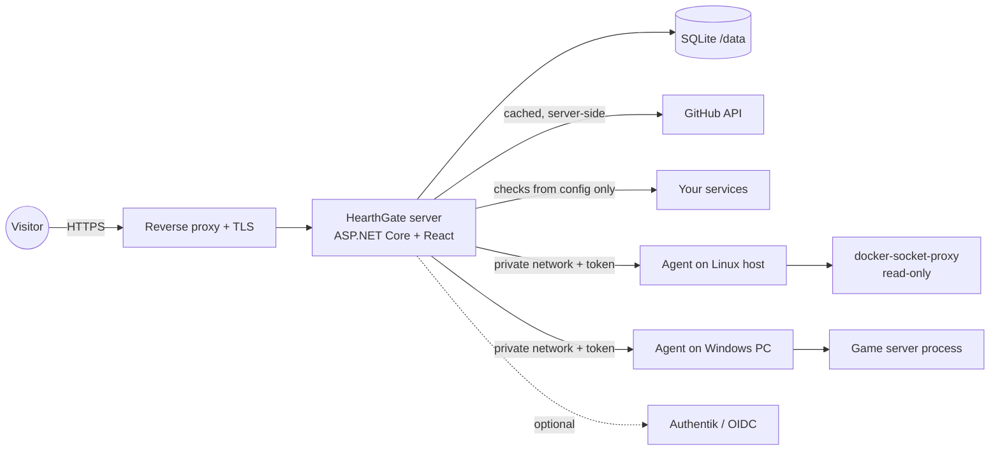

# HearthGate

A self-hosted home page for your services. Guests can see links and status. Approved users and admins can see more details and manage game servers.

- **Directory.** Cards with links to everything you host, grouped by category, with search.
- **Status.** Background checks (HTTP or TCP) show up, slow or down. Guests see only a coarse state.
- **Projects.** Your public GitHub repositories that have no website of their own.
- **Accounts.** No open sign-up. Visitors request an account; an admin approves it.
- **Permissions.** Groups give permissions such as `status.details`, `games.control:palworld`, `games.admin:palworld` or `hosts.view`.
- **Hosts and game servers.** The Hosts page (admins and `hosts.view`) shows each server on your network: reachable or not (ping and TCP ports), and, with the small agent, CPU, memory, disks and all Docker containers with their state, health and published ports. The agent also starts or stops allow-listed game servers.
- **Optional OIDC.** Sign in with Authentik (or any OIDC provider) and link it to an existing account. HearthGate works fully without it.
- **Modern UI.** Dark and light themes, animations (they respect "reduce motion"), mobile first.

Everything is configuration (`hearthgate.yaml`). Nothing is tied to one person's setup.

## Architecture



| Part | Technology |
|---|---|
| Server | ASP.NET Core (.NET 10) minimal APIs, EF Core + SQLite |
| Web UI | React 19, TypeScript, Vite, Tailwind CSS 4, Motion |
| Agent | .NET 10 worker; Docker container on Linux, Windows service on Windows |
| Packaging | One server image, one agent image, a Windows agent zip |

## Security model

The site is public, so the guest surface is small:

- Guest API answers contain only a name, description, icon, public link and a status word. No IPs, ports, hostnames, versions, container names, response times or error text.
- Guests read a cached snapshot. Checks run only in the background, only to targets in the config file. A request can never make the server probe a URL (no SSRF).
- Every endpoint checks permissions on the server. The UI only hides what the API already refuses.
- Passwords: PBKDF2-HMAC-SHA512 with 600,000 iterations (ASP.NET Core Identity hasher), 10 characters minimum. Lockout for 15 minutes after 5 failures. The same error for "unknown user" and "wrong password".
- Two-step sign-in (TOTP) is required before an admin can use admin tools (`auth.requireAdminTotp`). Codes cannot be used twice.
- Cookies are `__Host-` prefixed, `Secure`, `HttpOnly`, `SameSite`. Every state-changing request needs an antiforgery (CSRF) token.
- Sessions are revocable: password change, 2FA change, "sign out everywhere" and disabling a user all rotate a security stamp.
- Rate limits per IP: sign-in (10/min), account requests (3/15 min), and a global limit. Set `security.trustedProxies` so the real client IP is used behind a proxy.
- The account request form uses a self-hosted proof-of-work check and a honeypot. No third-party CAPTCHA and no tracking.
- Strict Content-Security-Policy (no inline scripts, no third-party content), `frame-ancestors 'none'`, `nosniff`, HSTS on HTTPS, no `Server` header. Fonts are bundled.
- Audit log of sign-ins, failures, requests, approvals, permission changes, links and game-server actions.
- Secrets only come from environment variables. The config file holds only the variable names (`tokenEnv`, `clientSecretEnv`).
- Containers run as a non-root user with a read-only root file system.
- Agents: bearer token (constant-time compare), optional client IP allow-list, never exposed through the proxy. Docker is read through a read-only socket proxy. Game servers can only be started, stopped or restarted, and only the ones listed in the agent config.

## Quick start (Docker)

1. Copy `deploy/docker-compose.example.yml` to a new folder as `docker-compose.yml`.
2. Copy `config/hearthgate.example.yaml` to `./data/hearthgate.yaml` and edit it.
3. Copy `config/agent.example.yaml` to `./agent/agent.yaml`. For a Docker host, set `docker.endpoint: http://docker-proxy:2375` and remove the example game.
4. Create `.env` with a random agent token: `HG_AGENT_NAS_TOKEN=<at least 24 random characters>`.
5. Give the data and agent folders to the container user: `sudo chown -R 1654:1654 ./data ./agent`. If the agent cannot read `agent.yaml`, it runs without Docker and the Hosts page shows no containers. On a NAS whose share ACLs block `sudo chown`, run it in a container: `docker run --rm -v "$PWD/agent:/a" alpine chown -R 1654:1654 /a`.
6. Start it: `docker compose up -d`.
7. Open the link in `./data/first-admin-link.txt` (through your proxy) to set the admin password. Delete the file after use.
8. Sign in, open **Profile**, and turn on two-step sign-in. Then the **Admin** page works.

Put a reverse proxy with TLS in front of port 8080 (for example Nginx Proxy Manager). The cookies need HTTPS.

## Configuration

See [`config/hearthgate.example.yaml`](config/hearthgate.example.yaml). Main sections:

| Section | What it controls |
|---|---|
| `site` | Title, tagline, accent color, logo, footer links |
| `categories` | Filter chips on the home page |
| `services` | Cards: `url` is the public link; `check.target` is the internal address that the server checks; `visibility` is `public`, `users` or `admins` |
| `hosts` | Servers on the Hosts page: `address` and `ports` for the network check (ping and TCP), and an optional `agentUrl` plus the env var that holds the agent token |
| `gameServers` | Game servers: the host and the `agentKey` in that agent's config |
| `github` | Owner, include/exclude lists, `hostedSites` (repos that have their own site are hidden) |
| `auth` | Local login, account requests, admin TOTP rule, session length, groups, optional `oidc` |
| `security` | Trusted proxies, proof-of-work difficulty |

HearthGate reloads the file when it changes. `auth.oidc` and `security.trustedProxies` need a restart.

Icons: use a built-in name (`film`, `book`, `mic`, `drama`, `gamepad`, `server`, `inbox`, `music`, `tv`, ...), an emoji, or a file in `/data/icons` (`icon: /icons/plex.svg`).

Environment variables:

| Variable | Use |
|---|---|
| `HG_CONFIG` | Config path (default `/data/hearthgate.yaml`) |
| `HG_DATA` | Data folder for the database, keys and icons (default `/data`) |
| `HG_ADMIN_USER` | Name of the first admin (default `admin`) |
| `HG_ADMIN_PASSWORD` | Optional first admin password. If not set, a one-time link is written to `first-admin-link.txt` |
| `HG_INSECURE_COOKIES` | `true` only for local development over plain HTTP |
| Names from the config | Agent tokens, GitHub token, OIDC client secret |

## Host agent

The agent gives HearthGate host health and game-server control. It listens on the private network only.

**Linux (Docker host):** use the `hearthgate-agent` and `docker-proxy` services in the compose example.

**Windows (game PC):** download `HearthGate.Agent-win-x64.zip` from the releases and unzip it. Edit `agent.yaml` (for Docker Desktop containers, set `docker.endpoint: npipe:////./pipe/docker_engine`), then run in PowerShell (not elevated):

```powershell
& "C:\Downloads\agent-win-x64\Install-HearthGateAgent.ps1" -SourceDir "C:\Downloads\agent-win-x64" -Token "<same token as in the server .env>" -AllowFrom 192.168.50.9
```

The script is `deploy/windows/Install-HearthGateAgent.ps1`. It installs the agent to `C:\HearthGate\Agent` and runs it from a scheduled task at logon, as the signed-in user, with no window. Game servers then start in your desktop session, the same as when you start them by hand. (A LocalSystem service runs in session 0, where windowed servers do not work.) The token goes into the user environment variable `HG_AGENT_TOKEN`. Windows asks once (UAC) to add the firewall rule: port 7177, only from the HearthGate server IP.

Game server kinds:

| Kind | Use |
|---|---|
| `script` | Recommended when you already have a control script. The agent runs `<script> -Server <scriptServer> -Action Status|Start|Stop|Restart -AsJson`. The script must print a JSON array of `{ Server, Running, SupervisorRunning }` for `Status`. |
| `process` | Start an exe; find and stop it by process names. |
| `windowsService` | Start and stop a Windows service. |
| `docker` | Start and stop a container (needs `POST=1` on the socket proxy). |

For Palworld, `palworldRest` (with `RESTAPIEnabled=True` in `PalWorldSettings.ini`) adds the player list and the version. Use `settingsIni` to read the admin password from the INI file, or `passwordEnv` for an env var.

### Server commands

Each game server can have its own commands, for example "Send a message", "Kick a player" or "Save the world". Users with control see them as buttons on the Games page. A button opens a form for the values of the command and shows the answer of the game server.

The commands are set in `agent.yaml`, on the host. The HearthGate server sends only a command ID and values. It never sends free command text. The agent checks each value (type, length, list of options, pattern) before it puts the value into the command. Text values cannot contain line breaks. Text values for `rcon` and `script` channels cannot contain a semicolon, because Source-engine consoles run each part as a separate command.

A **channel** tells the agent how to send commands:

| Channel | Use |
|---|---|
| `rcon` | The Source RCON protocol (`address: host:port`). Minecraft, ARK, Factorio, Counter-Strike 2 and many other games use it. |
| `http` | An HTTP API, for example the Palworld REST API (`url`, `auth: none, basic or bearer`, `username`). Each command sets `method`, `path` and an optional JSON `body`. |
| `script` | Your control script. The agent runs `<script> -Server <scriptServer> -Action Command -Command "<command text>"`. The output of the script is the answer. |

Passwords come from the environment variable in `passwordEnv`. When it is empty, `passwordIni` and `passwordIniKey` can read the password from the settings file of the game.

A **profile** gives a ready set of commands, a channel and stop steps. Set `profile:` on the game. Built-in profiles: `minecraft`, `palworld`, `factorio`, `source` (Counter-Strike 2, Team Fortress 2, Garry's Mod) and `ark-ascended`. The files are in `src/HearthGate.Agent/GameProfiles/`. To add or change a profile, put a YAML file with the same format in the `game-profiles` folder next to `agent.yaml` (or set `profilesDir`). A profile in that folder replaces a built-in profile with the same `id`.

Values on the game override the profile: `channel` fields replace profile fields one by one, a command with the same `id` replaces the profile command, and `disabled: true` removes a profile command. If the game has `palworldRest` and no `channel`, the Palworld profile uses its URL and password.

Each command has `id`, `label`, an optional `description`, and:

- `template` (rcon and script), for example `"kick {player} {reason}"`, or `method`, `path` and `body` (http), for example `'{"message":"{message}"}'`.
- `params`: each has `name`, `label`, `type` (`text`, `int` or `choice`), `required`, and `maxLength` and `pattern` (text), `min` and `max` (int), or `options` (choice). `default` is optional.
- `level`: `control` (default) needs `games.control:<id>`. `admin` needs `games.admin:<id>`.
- `confirm: true` shows a warning and a red Run button.
- `requiresRunning: false` lets the command run while the server is stopped (for example a backup script).
- `hidden: true` keeps the command out of the UI. Only stop steps can use it.

**Stop steps** run in order before a stop or a restart, when the server is running. A step can run a command (`command` and `params`), wait (`wait: <seconds>`), or wait until the server stops by itself (`waitForStop: <seconds>`). If the server stopped, the normal stop is not necessary. Set `stopSteps: []` on a game to turn off the profile steps. When stop steps are set, they replace the built-in Palworld save and shutdown of `palworldRest`.

Each command and its values go to the audit log, with the result.

Guests see each game server with **Online** or **Offline** only. `games.view` adds players, version and the connect address. The connect address shows to guests only with `connectInfoPublic: true`. Set `visibility` (`public`, `users`, `admins`) to hide a server. Start, stop, restart and server commands need `games.control:<id>` or `games.control:*`. Admin commands need `games.admin:<id>` or `games.admin:*`, which also give control. These actions run in the background, so a long graceful stop does not hit proxy time limits, and both the request and the result go to the audit log.

## Optional OIDC (Authentik or other providers)

1. In Authentik, create an **OAuth2/OpenID provider** (confidential client) and an application. Redirect URI: `https://<your HearthGate host>/signin-oidc`. Scopes: `openid`, `profile`, `email`.
2. In `hearthgate.yaml`, set `auth.oidc.enabled: true`, `authority` (for Authentik: `https://auth.example.com/application/o/<slug>/`) and `clientId`.
3. Put the client secret in the env var named by `clientSecretEnv` and restart.

`autoProvision` controls unknown OIDC users: `none` (refuse; the user must link first), `pending` (create an account request), or `approved` (create a member account at once). Optional `groupMap` maps provider groups to HearthGate groups at each sign-in.

## Accounts from other apps, migration and linking

**Can existing users move into Authentik with their passwords?** Authentik can import password hashes with `POST /api/v3/core/users/{id}/set_password_hash/` or the blueprint field `password_hash`. The hash must be in a Django format, for example `pbkdf2_sha256$<iterations>$<salt>$<hash>`, Argon2 or bcrypt.

CafeVox stores `base64(salt):base64(hash)` with PBKDF2-HMAC-SHA256, 100,000 iterations and a 16-byte random binary salt. Django's PBKDF2 hasher uses the salt as text (its UTF-8 bytes). A random binary salt is usually not valid text, so it cannot be written in the Django format, and the base64 text of the salt gives a different hash. Old CafeVox users with unsalted SHA-256 hashes cannot be imported at all. A custom Django hasher would need a custom Authentik image, so it is not recommended.

**Options:**

1. **Account linking (recommended).** Each app keeps its own users. Users connect their accounts when they want to.
2. **Move on next sign-in.** When a user signs in to the app, the app checks the old password and then creates the Authentik user with that password through the Authentik API. Each app needs extra code and an API token, and users who never sign in are not moved.
3. **Hash import.** Only for hashes that are already in a Django format. None of the current apps use one.

**How linking works:**

1. The user signs in to HearthGate with a username and password.
2. On the **Profile** page, the user clicks **Link Authentik**.
3. HearthGate sends the user to Authentik with a one-time `state` value.
4. The user signs in at Authentik. Authentik sends the user back.
5. HearthGate reads the issuer (`iss`) and the stable subject id (`sub`) from the ID token.
6. HearthGate stores (`iss`, `sub`) with the local account. One provider identity can link to one local account only.
7. Next time, **Sign in with Authentik** finds the account by (`iss`, `sub`). Permissions still come from HearthGate groups.

HearthGate never merges accounts by email address, because an email address can be changed or reused. A user can unlink only if another sign-in method remains.

**The same pattern for other apps:** CafeVox (or any other app) can add optional OIDC sign-in and a "Link account" button with the same (`iss`, `sub`) table. If OIDC is not configured, nothing changes for its users. Apps with no OIDC support keep their own accounts, or an admin can put private apps behind the Authentik proxy outpost (forward auth). Because Authentik is optional everywhere, people who host these apps without Authentik lose nothing.

## Development

Requirements: .NET 10 SDK and Node.js 20 or later.

```powershell
cd web; npm ci; npm run build; cd ..
$env:HG_INSECURE_COOKIES="true"; $env:HG_ADMIN_USER="admin"; dotnet run --project src/HearthGate.Server --urls http://127.0.0.1:5080
```

For live UI reloads, run `npm run dev` in `web` (it proxies `/api` to port 5080) while the server runs.

Run the agent locally:

```powershell
$env:HG_AGENT_TOKEN="<24+ characters>"; $env:HG_AGENT_CONFIG="C:\path\to\agent.yaml"; dotnet run --project src/HearthGate.Agent
```

The database is created on first start (`EnsureCreated`). After a schema change, delete the development database.

## Releases

`.github/workflows/release.yml` runs only when a `v*` tag is pushed or when it is started by hand. It builds and pushes `ghcr.io/<owner>/hearthgate` and `ghcr.io/<owner>/hearthgate-agent`, and for tags it attaches the Windows agent zip to a GitHub release. It runs no tests.

## License

See [LICENSE](LICENSE).
